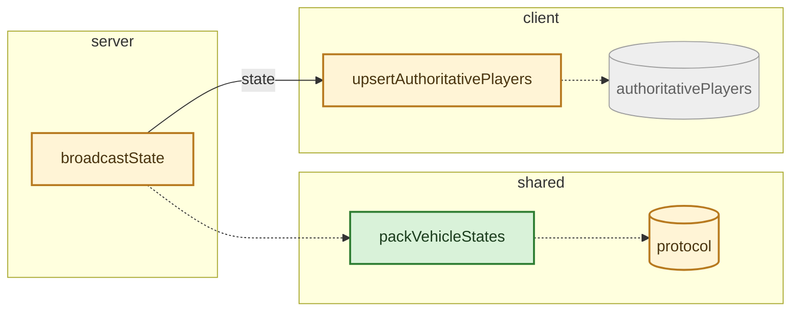
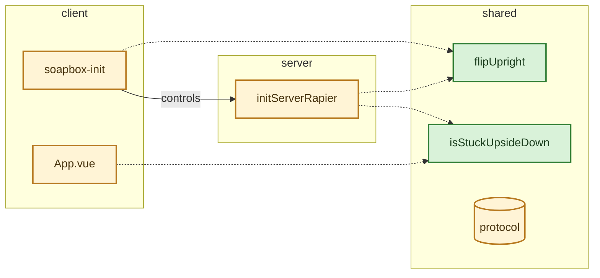

# Plan: flip button, multiplayer state fix, portrait mode

Status: **draft spec, for owner review.** Issue: ChaDonSom/game-loop#12. Choices for you are marked `YOUR CHOICE`.

Three changes. Each ships alone, in this order:

1. **M. Multiplayer state fix.** Root cause found and measured. It blocks every multiplayer playtest, so it goes first.
2. **F. Flip button.** A new input that must reach the server. Small protocol change.
3. **P. Portrait mode.** Client only.

Units: speeds in mph, with m/s in brackets where the code uses m/s. 1 m/s = 2.237 mph.

---

## M. Multiplayer state fix

### M1. Symptoms (from the issue)

With 4 players:

- When one player reloaded, another player's car jumped to some other spot.
- Not every player saw every car.
- Every player's count chip stayed green and kept counting.

### M2. Root cause: the `state` datagram is too big at 3 or more players

The server sends all cars in **one** `state` datagram (`broadcastState` in `node-transport/initServerRapier.ts`). Each car adds about 475 bytes of JSON: a 36-character UUID, field names, and 15 numbers at full double precision.

A QUIC datagram has a hard size limit. Measured here: Chromium reports `datagrams.maxDatagramSize = 1211` bytes for this server.

When a datagram is too big, the server drops it **without an error**. `@fails-components/webtransport` (`lib/session.js`, `createWritable`) treats a `tooBig` result from `writeDatagram` like success. `broadcastDatagram` also swallows write errors.

The `count` datagram is about 50 bytes. It always fits. So the chip stays green and keeps counting while no `state` arrives. (The chip shows seconds since connect, not players. Its `title` says "Players on the server". That is wrong.)

### M3. Evidence

Local run: real server (`node-transport/dist/server.js`), headless Chromium, 1 to 4 WebTransport sessions, each sends `controls` with throttle 0.5. One session counts the datagrams it gets in 3 s. At 30 Hz, it should get about 90 `state` packets.

| Sessions | `state` packets in 3 s | Sizes |
| --- | --- | --- |
| 1 | ~90 | 347–522 B |
| 2 | ~90 | 535–983 B |
| 3 | **6** | 586–927 B, only before the cars moved |
| 4 | **5** | 893–1217 B, only before the cars moved |

At spawn, the cars are at rest and many numbers are short (`7`, `1.5`, `0`). So a few packets fit just after a join. When the cars move, every number is about 18 digits, and every packet is too big.

The probe scripts are not in the repo. I can add them as a test if you want.

### M4. How the root cause makes each symptom

1. **Missing cars.** The client draws remote cars from `authoritativePlayers`. `upsertAuthoritativePlayers` replaces that map with the last `state` that arrived. With no new `state`, a player who joined later is never drawn. Cars that are drawn freeze.
2. **No correction.** The client's own car also gets no `state`, so `reconcile` does not run. Each client predicts its car alone. The server and the client then drift apart. Collisions make this fast: the server world has every car, but the client world has only its own car (remote cars are meshes, with no collider).
3. **Jump on reload.** A reload closes one session and opens another. For a moment, a `state` fits again: one less car, or a new car at rest at spawn. Every client then reconciles after a long gap. The error is bigger than `SNAP_DISTANCE` (4 m plus 0.1 m per m/s of speed), so `reconcile` snaps the car to the server pose. To the player, the car jumps "to some other spot". That spot is where the server had the car.

Point 3 is an inference. It agrees with the code and the measured drops. I did not reproduce it with 4 people driving.

### M5. Fix

**M5a. Split `state` into datagrams that fit.** The server packs as many cars as fit into each datagram, then starts a new one. All parts of one tick keep the same `seq`. The size budget is the session's `datagrams.maxDatagramSize`, with a fallback of 1100 B. One car always fits (~520 B), so a part is never empty.

**M5b. Per-car `seq` on the client.** Today `upsertAuthoritativePlayers` drops any `state` with `seq <= lastStateSeq`. With split packets, that would drop the second part of every tick. Change: keep the last `seq` for each car id. Drop a car entry only if its `seq` is not newer than that car's last one. Merge entries into `authoritativePlayers`. Do not replace the whole map.

**M5c. Remove stale cars by age.** Today a car leaves the map when it is missing from the next `state`. With a merge, it stays. The `leave` datagram can be lost (datagrams are unreliable). So also remove a car when it has had no entry for 1 s. `YOUR CHOICE`: 1 s, or another time.

**M5d. Smaller numbers (recommended, optional).** Round on the server before encode: position and velocity to 1 mm (3 decimals), rotation and spin to 4 decimals. This cuts a car to about 300 B, so 3 cars fit in one packet, and it halves the bandwidth. Client prediction does not need more precision than this: `reconcile` ignores errors under 0.25 m. Change only `broadcastState`. The shape stays the same.

**M5e. Never drop in silence.** Before a write, the server checks the size against `maxDatagramSize`. If the packet is too big, log a warning (at most once per minute per session). The next time a message grows, the log shows it at once.

**M5f. Real player count (optional).** Add `players: number` to `CountMessage`, and show it in the chip. Or fix the chip `title` to "Seconds connected". `YOUR CHOICE`.

### M6. What's new

`packVehicleStates(states, seq, t, maxBytes)` goes in `shared/src/protocol.ts`, next to the codec. It returns a list of encoded `VehicleStateMessage` parts. `protocol` changes only in its doc comment (a `state` can come in parts) and for M5f.

The message shape does not change, so an old client still works with a new server. It reads only the first part of each tick, so it does not draw cars in later parts. Deploy server and client together, as `deploy.sh` does.

### M7. Tests

- `tests/packVehicleStates.test.ts`: for 1 to 16 cars, every part is at most `maxBytes`, every car is in exactly one part, all parts have the same `seq`.
- Repeat the M3 probe: with 4 sessions, each session gets about 90 ticks in 3 s, and every tick has all 4 cars.

### M8. Not in this change

- **Remote cars in the client physics world.** On contact, the client cannot predict the hit, so `reconcile` snaps. M5 makes each snap small and early, not late and large. Kinematic colliders for remote cars are a separate change.
- **Spawn on a parked car.** `freeSpawnIndex` gives a free slot, even if another car is parked on that spot. The new car then pushes the parked car out. Possible fix: skip a slot whose spot is not clear (a Rapier shape test). `YOUR CHOICE`: include it here, or a later issue.

---

## F. Flip button

### F1. Why the server must flip the car

The server owns the car. A flip done only in the client lasts one `state`: the rotation error is more than `SNAP_ANGLE` (1 rad), so `reconcile` snaps the car back upside down. So the press must reach the server, and both sides must run the same flip code.

### F2. When the car can flip

New shared function `isStuckUpsideDown(body)`. True when all of these are true:

- The car's up axis points away from world up: `up.y < 0.3` (tilt more than about 73°). This includes a car on its side. `YOUR CHOICE`: side included, or only roof down (`up.y < 0`).
- Speed below 2 mph (0.9 m/s).
- Spin below 1 rad/s.

The client shows the button only while this is true for 0.5 s. So the button does not flash while the car tumbles.

### F3. The flip

New shared function `flipUpright(body)`, in `shared/src/rapier/chassis.ts`, next to `resetChassisToSpawn`:

- Keep the heading. Project the car's forward axis onto the ground plane. If forward points almost straight up or down, use the right axis.
- Set the rotation to upright with that heading.
- Lift the car 1 m, so the wheels clear the ground.
- Set velocity and spin to zero.

Then call `resetDriveState(vehicle)`.

### F4. Wire: a flip counter in `controls`

Add `flip?: number` to `ClientControlsMessage`: the count of flip presses this session.

- The client sends the counter in every `controls` datagram, so a lost datagram does not lose the press.
- The server keeps the last value it applied for each player. When a new value is higher, the server runs the flip if `isStuckUpsideDown` is true there. Otherwise it only stores the new value.
- Validator: `flip` is missing, or a non-negative integer.
- An old server ignores the field. An old client never sends it.

A one-shot "flip" message would need a reliable stream, or a retry and an ack. The counter needs neither.

### F5. Client prediction

On a press, the client adds 1 to the counter and runs `flipUpright` on its own car in the same physics step. The server flips about one uplink later. `reconcile` then sees a small error. If the server refused (its car was not stuck), the next `state` snaps the client car back. That is correct.

### F6. Button

- Same style as the reload pill (`.pill` in `App.vue`), but bigger: a thumb target of at least 44 px.
- Shown only while F2 is true (`v-if`).
- Place: `YOUR CHOICE`:
  - **(a) Top-right corner.** Recommended. Nothing is there now, and it is far from the pedals (bottom right) and the wheel (bottom left).
  - **(b) A second row** under the top bar, at the left.
- Key: `KeyF`. Gamepad: button Y (index 3), on press only. `YOUR CHOICE`: include the gamepad now, or later.

Frame budget (60 fps on your phone): the check runs each physics step, but the client sets the Vue ref only when the value changes. So there is no re-render or layout each frame.

### F7. What's new

`app -.-> stuck`: `App.vue` reads a ref that `soapbox-init` sets from `isStuckUpsideDown`. Not a direct call each frame.

### F8. Tests

- `tests/flip.test.ts`: a car at rest on its roof: `isStuckUpsideDown` is true. After `flipUpright`, up points up, the heading is the same, and after 2 s of steps the car rests on its wheels.
- A car upright, or on its roof but still moving: `isStuckUpsideDown` is false.

---

## P. Portrait mode

### P1. Root cause

Two places lock landscape:

1. `vue-client/public/manifest.webmanifest`: `"orientation": "landscape"`. An installed PWA starts locked to it.
2. `toggleFullscreen` in `App.vue`: `screen.orientation.lock("landscape")` after it enters fullscreen.

### P2. Fix

- New stored choice `orientation`: `"landscape" | "portrait"`, with `storedChoice` from `vue-client/src/input/storedChoice.ts`. Default `"landscape"`, so the first start is the same as today.
- A pill button toggles it, and calls `screen.orientation.lock(choice)`.
- At start, in an installed PWA, apply the stored choice. `toggleFullscreen` also uses the stored choice, not a fixed `"landscape"`.
- Show the button only where `screen.orientation.lock` exists, and in an installed PWA or in fullscreen. Other cases cannot lock. Desktop and iPhone Safari do not have `lock`, so the button stays hidden there.
- Keep the manifest as `"landscape"`. `YOUR CHOICE`: keep it, or set `"any"` and let the stored choice do all locking.

Not verified yet: that Chrome on Android allows `lock("portrait")` in an installed PWA without a fullscreen request. The spec says yes for installed apps. I must test it on your phone, or you must.

### P3. Icon

You asked for the icon that Android uses to swap orientation. Material Symbols has two near matches: `screen_rotation` (a phone with two curved arrows) and `screen_rotation_alt`. I am not sure which one your Android version shows. `YOUR CHOICE`: I will put both in the review PR, and you pick.

Material Symbols uses the Apache 2.0 license. I will copy the SVG path inline, with a license comment.

### P4. Portrait layout

`TouchControls.vue` sizes from the short side of the screen (`shortSide`), so the wheel and pedals scale. Check with screenshots at 390 × 844 and 844 × 390. The top bar can wrap in portrait. Put the flip and rotate buttons where wrap does not hide them.

---

## Order and PRs

Three PRs against `soapbox-car`, in the order M, F, P. Or one PR with three commits. `YOUR CHOICE`. I recommend three PRs: M changes netcode, and you can playtest it alone with 4 players.

## Checks before each push

- `npm ci --ignore-scripts` and `npm run build`.
- The tests in `tests/`.
- `npx --yes jscpd` on the changed directories (per `copilot-instructions.md`).
- M: the 4-session probe from M3.
- F and P: screenshots at phone size. For frame time, I need your `?perf` readout from the phone. Headless Chromium renders on the CPU, so it cannot show the phone's GPU cost.

## Your choices, in one list

1. M5c: stale-car timeout, 1 s?
2. M5d: round the numbers? (recommended)
3. M5f: real player count in the chip, or fix its title?
4. M8: spawn-slot clear check now, or later?
5. F2: car on its side can flip, or only on its roof?
6. F6: button in the top-right corner (recommended) or a second row? Gamepad button now?
7. P2: manifest `"landscape"` or `"any"`?
8. P3: `screen_rotation` or `screen_rotation_alt`?
9. Three PRs, or one?
