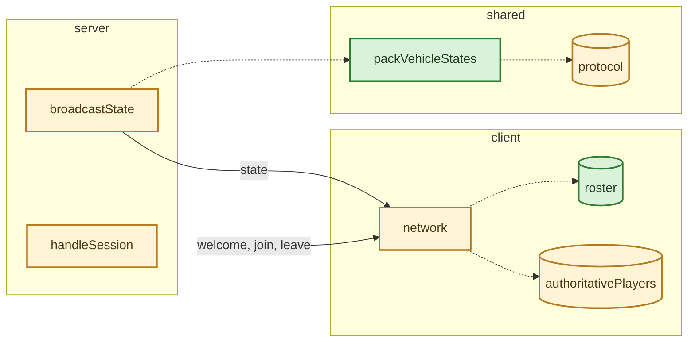
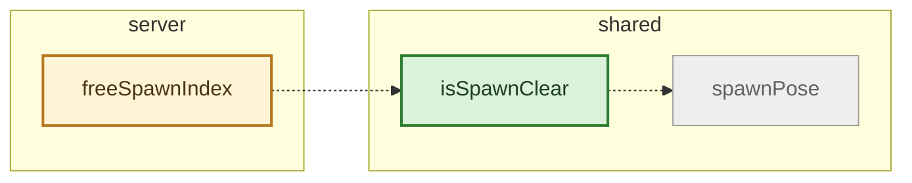
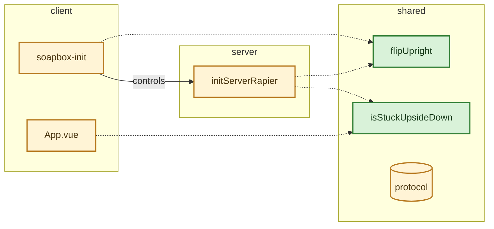

# Plan: flip button, multiplayer state fix, portrait mode

Status: **approved (revision 3). Scaffold pushed in this PR.** Issue: ChaDonSom/game-loop#12. Your slots are marked `YOUR CHOICE` in the code.

Revision 3: you chose yes for rounding (M5d) and a player count in the chip (M5f).

Revision 2 changes, from your first review:

- Join and leave go on the reliable channel (M5c). The stale-car timeout is gone.
- The spawn clear check is in this change (M5g).
- Remote-car colliders are saved as ChaDonSom/game-loop#13 and in `notes/roadmap.md`.
- F4 says why the flip counter beats a reliable message.
- Your choices are filled in: side flips count, top-right button with an ellipsis tagline, gamepad now, manifest `"any"`, `screen_rotation`, one PR.

Three parts, in one PR, in this order:

1. **M. Multiplayer state fix.** Root cause found and measured. It blocks every multiplayer playtest, so it goes first.
2. **F. Flip button.** A new input that must reach the server. Small protocol change.
3. **P. Portrait mode.** Client only.

Units: speeds in mph, with m/s in brackets where the code uses m/s. 1 m/s = 2.237 mph.

---

## M. Multiplayer state fix

### M1. Symptoms (from the issue)

With 4 players:

- When one player reloaded, another player's car jumped to some other spot.
- Not every player saw every car.
- Every player's count chip stayed green and kept counting.

### M2. Root cause: the `state` datagram is too big at 3 or more players

The server sends all cars in **one** `state` datagram (`broadcastState` in `node-transport/initServerRapier.ts`). Each car adds about 475 bytes of JSON: a 36-character UUID, field names, and 15 numbers at full double precision.

A QUIC datagram has a hard size limit. Measured here: Chromium reports `datagrams.maxDatagramSize = 1211` bytes for this server.

When a datagram is too big, the server drops it **without an error**. `@fails-components/webtransport` (`lib/session.js`, `createWritable`) treats a `tooBig` result from `writeDatagram` like success. `broadcastDatagram` also swallows write errors.

The `count` datagram is about 50 bytes. It always fits. So the chip stays green and keeps counting while no `state` arrives. (The chip shows seconds since connect, not players. Its `title` says "Players on the server". That is wrong.)

### M3. Evidence

Local run: real server (`node-transport/dist/server.js`), headless Chromium, 1 to 4 WebTransport sessions, each sends `controls` with throttle 0.5. One session counts the datagrams it gets in 3 s. At 30 Hz, it should get about 90 `state` packets.

| Sessions | `state` packets in 3 s | Sizes |
| --- | --- | --- |
| 1 | ~90 | 347–522 B |
| 2 | ~90 | 535–983 B |
| 3 | **6** | 586–927 B, only before the cars moved |
| 4 | **5** | 893–1217 B, only before the cars moved |

At spawn, the cars are at rest and many numbers are short (`7`, `1.5`, `0`). So a few packets fit just after a join. When the cars move, every number is about 18 digits, and every packet is too big.

The probe scripts are not in the repo. I can add them as a test if you want.

### M4. How the root cause makes each symptom

1. **Missing cars.** The client draws remote cars from `authoritativePlayers`. `upsertAuthoritativePlayers` replaces that map with the last `state` that arrived. With no new `state`, a player who joined later is never drawn. Cars that are drawn freeze.
2. **No correction.** The client's own car also gets no `state`, so `reconcile` does not run. Each client predicts its car alone. The server and the client then drift apart. Collisions make this fast: the server world has every car, but the client world has only its own car (remote cars are meshes, with no collider).
3. **Jump on reload.** A reload closes one session and opens another. For a moment, a `state` fits again: one less car, or a new car at rest at spawn. Every client then reconciles after a long gap. The error is bigger than `SNAP_DISTANCE` (4 m plus 0.1 m per m/s of speed), so `reconcile` snaps the car to the server pose. To the player, the car jumps "to some other spot". That spot is where the server had the car.

Point 3 is an inference. It agrees with the code and the measured drops. I did not reproduce it with 4 people driving.

### M5. Fix

**M5a. Split `state` into datagrams that fit.** The server packs as many cars as fit into each datagram, then starts a new one. All parts of one tick keep the same `seq`. The size budget is the session's `datagrams.maxDatagramSize`, with a fallback of 1100 B. One car always fits (~520 B), so a part is never empty.

**M5b. Per-car `seq` on the client.** Today `upsertAuthoritativePlayers` drops any `state` with `seq <= lastStateSeq`. With split packets, that would drop the second part of every tick. Change: keep the last `seq` for each car id. Drop a car entry only if its `seq` is not newer than that car's last one. Merge entries into `authoritativePlayers`. Do not replace the whole map.

**M5c. Join and leave on the reliable channel.** Revised per your review: arrive and leave go reliable.

The rule, from first principles: a datagram is enough when a later packet repeats the same fact. `state` and `controls` repeat 30 times a second, so a lost one does not matter. A leave is a one-time event. After it, no packet repeats "this car is gone". Today, absence from the next `state` does that job by accident. With `state` in parts (M5a), absence means nothing. So join and leave must not be lost.

Design:

- New stream messages in `shared/src/protocol.ts`: `join { id, rosterSeq }` and `leave { id, rosterSeq }`. The `leave` datagram goes away.
- `welcome` gains `players: string[]` (who is connected now) and `rosterSeq`.
- `rosterSeq` is one server counter. It goes up by 1 on each join or leave.
- Why a counter: the server opens a new stream for each message, and separate streams have no order between them. A `leave` can arrive before the `join` of the same car. The client keeps the last `rosterSeq` per id, and ignores an older event for that id. A `leave` also leaves a mark, so a late `join` cannot bring the car back.
- The client draws a car only while the roster has it. It ignores a `state` entry for an id that is not in the roster. Without this, a late `state` datagram after a `leave` would bring the car back.
- No timeout is needed. The 1 s choice is gone.

What reliable delivery does not fix: the server must first see that the session closed. On a reload, the page can go before the close reaches the server. Then the server waits for the QUIC idle timeout, and the old car stays on the road for that time. So the client also closes the transport on `pagehide`. In the build, I will measure the time from reload to server cleanup, and report it.

**M5d. Smaller numbers.** Approved. Round on the server before encode: position and velocity to 1 mm (3 decimals), rotation and spin to 4 decimals. This cuts a car to about 300 B, so 3 cars fit in one packet, and it halves the bandwidth. Client prediction does not need more precision than this: `reconcile` ignores errors under 0.25 m. Change only `broadcastState`. The shape stays the same.

**M5e. Never drop in silence.** Before a write, the server checks the size against `maxDatagramSize`. If the packet is too big, log a warning (at most once per minute per session). The next time a message grows, the log shows it at once.

**M5f. Real player count.** With the roster (M5c), the client knows who is connected. The chip shows the roster size, with no protocol change. Approved.

**M5g. Spawn only on a clear spot.** Included per your review. `freeSpawnIndex` now also skips a slot when another car is on its spot.

- New shared function `isSpawnClear(world, spawnIndex)` in `shared/src/rapier/chassis.ts`, next to `spawnPose`. It runs a Rapier shape test (`world.intersectionWithShape`) with the chassis box at that pose, and skips fixed colliders (ramp, ground, walls), so only cars count.
- `freeSpawnIndex` takes the first slot that no player holds **and** that is clear.
- It tries at most a fixed number of slots. If none is clear, it uses the first free slot, as today. The limit is a slot in the scaffold: each row is 3 m further down the ramp, so you pick how far down a spawn can go.
- Size: about 20 lines plus one test. Small enough for this change.

### M6. What's new

Two diagrams: the state and roster path, then the spawn check.

`packVehicleStates(states, seq, t, maxBytes)` goes in `shared/src/protocol.ts`, next to the codec. It returns a list of encoded `VehicleStateMessage` parts. `roster` is a new client store next to `authoritativePlayers` in `vue-client/src/store/network.ts`: id to `{ present, rosterSeq }`.

`protocol` changes: `welcome` gains two fields, `join` and the stream `leave` are new, and the datagram `leave` goes away. An old client cannot read the new roster. Deploy server and client together, as `deploy.sh` does. So `protocol.ts` gains `PROTOCOL_VERSION = 2`, and `WORLD_VERSION` hashes it with the world data. The version then changes, and a stale tab gets the existing mismatch notice instead of a half-working roster.

### M7. Tests

- `tests/packVehicleStates.test.ts`: for 1 to 16 cars, every part is at most `maxBytes`, every car is in exactly one part, all parts have the same `seq`.
- `tests/roster.test.ts`: events in any order give the same roster. A `leave` before its `join` keeps the car out. A `state` entry for an id that is not present is ignored.
- `tests/spawnClear.test.ts`: a car parked on slot 0 makes `isSpawnClear(world, 0)` false. With slot 0 empty, it is true. The ramp under the slot does not count.
- Repeat the M3 probe: with 4 sessions, each session gets about 90 ticks in 3 s, and every tick has all 4 cars. Then close one session, and check the other sessions drop its car.

### M8. Not in this change

- **Remote cars in the client physics world.** On contact, the client cannot predict the hit, so `reconcile` snaps. M5 makes each snap small and early, not late and large. Kinematic colliders for remote cars are a separate change. Saved as ChaDonSom/game-loop#13, and in `notes/roadmap.md` under "Later".

---

## F. Flip button

### F1. Why the server must flip the car

The server owns the car. A flip done only in the client lasts one `state`: the rotation error is more than `SNAP_ANGLE` (1 rad), so `reconcile` snaps the car back upside down. So the press must reach the server, and both sides must run the same flip code.

### F2. When the car can flip

New shared function `isStuckUpsideDown(body)`. True when all of these are true:

- The car's up axis points away from world up: tilt more than about 73° (`up.y < 0.3`). This includes a car on its side, as you chose. The exact tilt is a slot in the scaffold.
- Speed below 2 mph (0.9 m/s).
- Spin below 1 rad/s.

The client shows the button only while this is true for 0.5 s. So the button does not flash while the car tumbles.

### F3. The flip

New shared function `flipUpright(body)`, in `shared/src/rapier/chassis.ts`, next to `resetChassisToSpawn`:

- Keep the heading. Project the car's forward axis onto the ground plane. If forward points almost straight up or down, use the right axis.
- Set the rotation to upright with that heading.
- Lift the car 1 m, so the wheels clear the ground.
- Set velocity and spin to zero.

Then call `resetDriveState(vehicle)`.

### F4. Wire: a flip counter in `controls`

Add `flip?: number` to `ClientControlsMessage`: the count of flip presses this session.

- The client sends the counter in every `controls` datagram, so a lost datagram does not lose the press.
- The server keeps the last value it saw for each player. Any change is a press (out-of-order datagrams are already dropped), so the count never needs a reset, even across reconnects. On a press, the server runs `tryFlip`: it flips only if the car is stuck there and the lifted spot is clear.
- Validator: `flip` is missing, or a non-negative integer.
- An old server ignores the field. An old client never sends it.

Why a counter in `controls`, not a reliable message (you asked about this in review). Join and leave go reliable (M5c), so this needs a reason:

- **The same delivery guarantee.** Join and leave have nothing that repeats them. A flip press does: `controls` goes 30 times a second, and every packet carries the counter. One packet out of many must arrive, and that is the same guarantee a reliable stream gives, as long as the car is connected.
- **Less delay on loss.** A lost stream packet waits for a retransmit, at least one round trip. A lost `controls` datagram costs about 33 ms, until the next one.
- **Order with the inputs.** The server applies `controls` one packet at a time, in the physics step. The flip then lands in the same step as the pedal and steer values sent with it. A stream message is not ordered with datagrams, so the flip could land a few steps earlier or later than in the client's prediction. Then `reconcile` would correct it.

So the counter is better here.

### F5. Client prediction

On a press, the client adds 1 to the counter and runs the same `tryFlip` on its own car in the same physics step. The server flips about one uplink later. Server states that predate the flip still show the car on its roof, so the client skips every state whose `ack` is at or below the last datagram it sent before the flip. For this, `ack` is the seq of the controls that a server physics step **applied**, not just received: the 30 Hz broadcast runs apart from the physics steps. If the server refused (its car was not stuck), the next `state` snaps the client car back. That is correct.

### F6. Button

- Same style as the reload pill (`.pill` in `App.vue`), but bigger: a thumb target of at least 44 px.
- Shown only while F2 is true (`v-if`).
- Place: **top-right corner**, as you chose. It is far from the pedals (bottom right) and the wheel (bottom left).
- The top bar ends with the tagline ("Simple soapbox cars in a shared physics environment."). When the tagline and the button do not both fit, the tagline cuts off with an ellipsis (`…`). The pills never shrink.
- Key: `KeyF`. Gamepad: button Y (index 3), on press only. Both in this change.

Frame budget (60 fps on your phone): the check runs each physics step, but the client sets the Vue ref only when the value changes. So there is no re-render or layout each frame.

### F7. What's new

`app -.-> stuck`: `App.vue` reads a ref that `soapbox-init` sets from `isStuckUpsideDown`. Not a direct call each frame.

### F8. Tests

- `tests/flip.test.ts`: a car at rest on its roof: `isStuckUpsideDown` is true. After `flipUpright`, up points up, the heading is the same, and after 2 s of steps the car rests on its wheels.
- A car upright, or on its roof but still moving: `isStuckUpsideDown` is false.

---

## P. Portrait mode

### P1. Root cause

Two places lock landscape:

1. `vue-client/public/manifest.webmanifest`: `"orientation": "landscape"`. An installed PWA starts locked to it.
2. `toggleFullscreen` in `App.vue`: `screen.orientation.lock("landscape")` after it enters fullscreen.

### P2. Fix

- New stored choice `orientation`: `"landscape" | "portrait"`, with `storedChoice` from `vue-client/src/input/storedChoice.ts`. Default `"landscape"`, so the first start is the same as today.
- A pill button toggles it, and calls `screen.orientation.lock(choice)`.
- At start, in an installed PWA, apply the stored choice. `toggleFullscreen` also uses the stored choice, not a fixed `"landscape"`.
- Show the button only where `screen.orientation.lock` exists, and in an installed PWA or in fullscreen. Other cases cannot lock. Desktop and iPhone Safari do not have `lock`, so the button stays hidden there.
- Set the manifest to `"orientation": "any"`, as you chose. The stored choice then does all locking. If `lock` fails at start, the app turns with the phone. That is an open state, not a stuck one.

Not verified yet: that Chrome on Android allows `lock("portrait")` in an installed PWA without a fullscreen request. The spec says yes for installed apps. I must test it on your phone, or you must.

### P3. Icon

Material Symbols `screen_rotation` (a phone with two curved arrows), as you chose.

Material Symbols uses the Apache 2.0 license. I will copy the SVG path inline, with a license comment.

### P4. Portrait layout

`TouchControls.vue` sizes from the short side of the screen (`shortSide`), so the wheel and pedals scale. Check with screenshots at 390 × 844 and 844 × 390. The top bar can wrap in portrait. Put the flip and rotate buttons where wrap does not hide them.

---

## Order and PRs

One PR against `soapbox-car`, as you chose. Commits in the order M, F, P, so each part can be read and reverted alone.

## Checks before each push

- `npm ci --ignore-scripts` and `npm run build`.
- `npm test`.
- `npx --yes jscpd` on the changed directories (per `copilot-instructions.md`).
- M: the 4-session probe from M3.
- F and P: screenshots at phone size. For frame time, I need your `?perf` readout from the phone. Headless Chromium renders on the CPU, so it cannot show the phone's GPU cost.

## Your slots

All plan choices are made. Tuning values (rounding precision, flip tilt, stuck speed and spin, flip lift, button delay, spawn-slot limit) are `YOUR CHOICE` slots in the code, per `AGENTS.md`.
