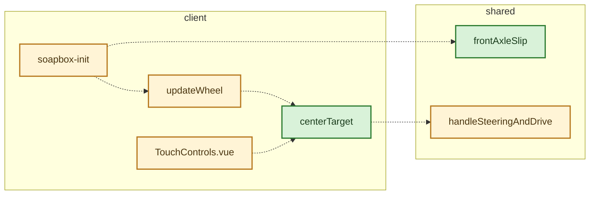
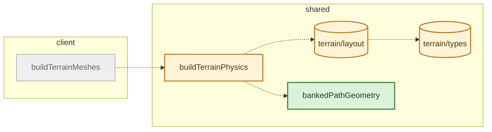

# Plan: tangent wheel drag, slide-aware centering, banked oval and S curve

Status: **approved. Scaffold pushed in this PR.** Your slots are marked `YOUR CHOICE` in the code.

Revision 2 changes:

- The bottom-half slider (S) is **shelved**. Your reasons are kept below in "Shelved: bottom-half slider".
- **Tangent drag (W)** takes its place. Its plan is your attachment, now `notes/plans/tangent-wheel-drag.md`.
- The cue (C5) is now a **gap arc** plus a **haptic tap**, as you chose.
- Banked roads (T): longer bank transitions, a way onto the oval, a barrier choice, placement, and speeds in mph.
- Keys keep today's centering. The old banked turn stays, with longer transitions.

Three changes in one PR. Each can ship alone, in this order:

1. **Tangent wheel drag (W).** An optional drag mode for the touch wheel. See `notes/plans/tangent-wheel-drag.md`.
2. **Slide-aware centering (C).** A released touch wheel goes to where the front wheels "want" to point, not to 0. A gap arc and a haptic tap show that angle.
3. **Banked oval and banked S curve (T).** Two new track pieces, from one general banked-road builder.

Not in this plan: slide-aware centering for keys and gamepad. Keys center in `shared/src/controls/handleSteeringAndDrive.ts` (`steering *= 0.9`), and that stays. A gamepad has a physical spring, so only force feedback could do it.

Units: speeds are in mph, with m/s in brackets where the code uses m/s. 1 m/s = 2.237 mph.

## How this fits

The touch wheel is a client-only input. `vue-client/src/input/touch.ts` holds `wheelAngle`. `getTouchPad()` turns it into `pad.steer`. The pad goes to the server in `controls`. The server never sees the wheel, only `pad.steer`.

So changes W and C are **client only**. They change what the client sends, not how physics runs. No protocol change. No server change. Prediction stays correct, because the server applies the same `pad.steer` the client applied.

Change T is shared data. Server and client build the same colliders from `DEFAULT_TERRAIN_LAYOUT`. The `worldVersion` hash covers the layout, so an old tab sees a mismatch (from the terrain step, D5).

## What's new

Three diagrams, one per change. Legend: `notes/diagram-legend.md`. Node names are planned names.

**W. Tangent wheel drag.** The diagram is in `notes/plans/tangent-wheel-drag.md`.

**C. Slide-aware centering.**



`target -.-> drive`: `centerTarget` reads `MAX_STEERING`, which `handleSteeringAndDrive.ts` must export (today it is a local `maxSteering`). `tc -.-> target`: the gap arc and the haptic tap read the target.

**T. Banked roads.**



No solid edge in any diagram: nothing new crosses the network.

`buildTerrainMeshes` needs no change. It already builds a mesh from any `TriMesh` collider.

---

## W. Tangent wheel drag

Full plan: `notes/plans/tangent-wheel-drag.md` (approved). It is your attachment from the review. I changed only its links to the shelved slider and to the C5 cue.

Why it fits your review: in the heat of the moment you grab the wheel and pull in the direction you want, then run out of circle. Tangent drag makes that pull a straight slider, set by where you grab. Angular drag stays as the default, so the circling interaction is still there.

## Shelved: bottom-half slider

Plan revision 1 had a slider: a drag in the bottom half of the screen steered by its x position. It is on hold. Your reasons, from the review:

- **Space.** The free bottom-half area exists only in portrait, not in landscape.
- **Thumb clash.** In landscape, steering to full right lock puts the steering thumb over the gas thumb, at the far right.
- **Steer snap.** An absolute slider jumps steer to the finger at touch-down. Not severe, but it adds to the other two.
- **A better idea exists.** Tangent drag (W) keeps the "pull in a straight line" feel on the wheel itself, with no new screen area.

If it comes back, revision 1 of this file (commit `3721715`) has the full design: owner record, span, dead zone, curve.

---

## C. Slide-aware centering

### C1. What reality does

Sources and confidence are at the end of this section.

Two separate effects turn a released steering wheel:

1. **Mechanical trail and kingpin inclination ("caster effect").** The tire contact patch sits behind the steering axis. A side force on the tire acts on that lever. It turns the tire **into the direction the tire is moving**, like a shopping-cart caster. Steering axis tilt also lifts the car a little when you steer, so the car's weight also pushes the wheels back toward straight. That second part works even at very low speed.
2. **Pneumatic trail (tire self-aligning torque).** The tire's own side force acts a little behind the patch center. This adds to effect 1 at small slip angles. At large slip angles this trail collapses, and the steering "goes light". The mechanical trail stays.

Result. With the wheel released, the front tires turn until their **side force is 0**. Side force is 0 when the front tire points exactly where the front axle is moving. That is **0 front slip angle**.

- Driving straight: the front axle moves straight ahead. Target = straight. Same as today.
- Oversteer slide: the rear swings out. The front axle moves toward the outside of the turn, relative to the car's nose. Target = **countersteer**, by the full angle between the nose and the front axle's path (up to lock). Not "slightly". In a big slide it can be a lot.
- That is why drifters let the wheel spin through their hands. The car finds the countersteer angle by itself. Then they catch the wheel when it is at the right point. Your plan to "let go, then pull it again" matches real technique.

One more real effect: when the rear grip comes back, the target swings back fast. A driver who holds full countersteer too long gets a slide the other way (a "tank-slapper"). Our centering never passes its target, so it follows the target as it swings back. It cannot overshoot by itself.

### C2. The model

`frontAxleSlip(body, frontOffset)` in `shared/src/vehicle/slip.ts`:

- Velocity of the front axle center: `v + ω × r`, with `r` = front axle offset in world frame. Front axle offset = `-length/3` along the chassis, from `shared/src/rapier/wheels.ts`.
- Split it into chassis forward and chassis lateral parts.
- Return the road-wheel angle that points along that velocity: `atan2(lateral, forward)`, plus the forward speed.
- Pure function in `shared`, so a gamepad force-feedback or a slip HUD can use it later. It reuses the chassis-axes math in `forwardSpeed` (moved to `shared/src/math.ts`, not copied).

`updateWheel` today moves `wheelAngle` toward 0 by a rate that grows with front rolling speed. New: it moves toward `centerTarget(...)` with the **same rate rule**. Only the target changes.

`centerTarget` converts the road-wheel angle to a wheel angle: `roadAngle / MAX_STEERING × halfLock`, clamped to the lock. (If you change `applyCurve` from linear, this needs its inverse. The scaffold notes it.)

Sign check: `touch.ts` uses clockwise = positive = steer right. Rapier steering is the other sign. The scaffold includes a small headless test: a car that slides left must give a target to the left of the nose, measured in wheel degrees. I verify the sign before you tune.

### C3. Effect 1 vs effect 2 at low speed

The 0-front-slip target is not defined at a stop (`atan2(0, 0)`), and in reverse it flips. In reality, effect 1's weight part centers toward straight at low speed, where side forces are small.

So the target is a blend: straight at low speed, 0 front slip at speed. How you blend is a slot (C4).

### C4. Your slots

| Slot | File (planned) | Decision | Where to look |
| --- | --- | --- | --- |
| Target blend | `vue-client/src/input/touch.ts`, `centerTarget` | How the target goes from straight (stopped, reverse) to 0 front slip (moving). Speed where it changes. | Reverse at walking speed (about 3 mph) and release. Then slide at speed and release. |
| Align gain | same | Fraction of the 0-front-slip angle to use, 0…1. 1 = what reality does (C1). | You asked for "slightly". Try 1 first, then lower it, and compare how a slide ends. |
| Rate in a slide | same, `centerStep` | Keep the rolling-speed rate, or add a faster rate when the gap to target is large. | Real wheels snap to countersteer fast in a slide. Is the current 960°/s cap fast enough? |

Prediction to check, before you run it: with align gain 1 and **no slide**, you release the wheel mid-corner. The target is then about the current steer, minus a small front slip. Does the wheel still return to straight? How fast, compared with today? (Hint: what happens to the car's path as the wheel moves a little toward the target?)

### C5. The cue: gap arc and haptic tap

Your choice from the review: **gap arc** (2) and **haptic tap** (6). The arc is easier to read from the edge of your vision than a second notch. It also shows in normal turning, because the wheels "want" to go back toward straight while you hold a turn.

The six options from revision 1, for reference: ghost notch, gap arc, slider tick, 3D arrow, rim tint, haptic.

**Gap arc**

- An arc on the wheel rim, from the real notch (the current angle) to the target angle (`centerTarget`).
- Shows whenever the gap is larger than a small threshold, held or not. So it also shows in a normal corner.
- Drawn in `TouchControls.vue`, in the wheel SVG. It does not rotate with the wheel group: its two ends are absolute angles.
- Problem: the wheel turns ±450°, so the gap can be up to 900°. An arc cannot show more than one turn. Plan: draw at most 330° of arc, and put a small arrowhead on the far end when the gap is larger. "Keep going."
- The tangent mode target mark (`tangent-wheel-drag.md`, W6) is a different cue, with its own toggle. Both read the same `centerTarget`.

**Haptic tap**

- One short `navigator.vibrate` pulse when the held wheel **reaches** the countersteer target: the gap changes sign while held.
- Only for countersteer: the tap fires only while the car slides (front slip larger than a threshold). Without that rule, every normal corner would tap when you pass straight.
- At most one tap per grab, until the gap grows past the threshold again. So a thumb that rests on the target does not buzz.
- Android only. iOS Safari has no `navigator.vibrate`. There the arc is the only cue.

**Your slots (C5)**

| Slot | File (planned) | Decision | Where to look |
| --- | --- | --- | --- |
| Arc look | `vue-client/src/components/TouchControls.vue` (SVG + scoped CSS) | Width, color, color by gap size, show threshold. | A normal corner and a slide. Can you read it without looking straight at the wheel? |
| Tap | `vue-client/src/input/touch.ts` | Pulse length (ms), and the front slip that counts as "sliding". | Slide, let go, catch. Does the tap come at the moment you would grab? Does a normal corner stay quiet? |

### C6. Sources and confidence

- Mechanical trail and caster turn the tire into the side force: [Caster angle, Wikipedia](https://en.wikipedia.org/wiki/Caster_angle). Confident.
- Pneumatic trail falls as slip angle grows, so self-aligning torque falls near the limit: [Pneumatic trail, Wikipedia](https://www.wikipedia.org/wiki/Pneumatic_trail), [Self aligning torque, Wikipedia](https://en.wikipedia.org/wiki/Self_aligning_torque). Confident.
- Restoring moment = side force × (pneumatic trail + caster trail), so the caster part remains when the pneumatic part collapses: [US patent 6895317](https://image-ppubs.uspto.gov/dirsearch-public/print/downloadPdf/6895317) (grip estimation patents use this). Confident in the form. Not checked: real magnitudes.
- "Released wheel goes to 0 front slip, which is full countersteer in a slide": my derivation from the lines above, plus the common drift advice to let the wheel self-steer. I found no measured source for how fast a real wheel gets there, or how power steering changes it. Treat the rate as a feel choice, not a fact.

---

## T. Banked oval and banked S curve

### T1. One general builder

Today `bankedTurnGeometry` builds one arc that bends toward −X. An oval and an S curve need straights, both turn directions, and a bank that changes sides.

Plan: replace the `bankedTurn` kind with a **`bankedPath`** kind. A path is a list of segments. One geometry builder walks the list.

```ts
type PathSegment =
  | { type: "straight"; length: number }
  | { type: "arc"; turn: "left" | "right"; radius: number; angle: number }

type BankedPathPiece = PieceBase & {
  kind: "bankedPath"
  roadWidth: number
  segments: PathSegment[]
  /** Full bank on arcs, radians. Straights are flat. The outer edge of each arc is the high edge. */
  bankAngle: number
  /** Length (m) of road over which the bank changes, at each segment boundary. */
  easeLength: number
  /** Height (m) of a wall on the high edge of arcs. 0 = none. Straights have no wall. */
  barrierHeight: number
  /** Last point joins the first. For an oval. */
  closed: boolean
  /** Samples per metre along the center line. */
  resolution: number
}
```

- The **low edge stays on the ground** and the high edge lifts. On a left arc the left edge is low, on a right arc the right edge is low. Why not pivot on the center line: half the road would go below `y = 0`, into the ground box.
- `bankedPathGeometry` replaces `bankedTurnGeometry`. Same output: `{ vertices, indices }`, used for the `trimesh` collider and, through it, the mesh.

### T2. Bank transitions (longer)

You found today's transition too short. Today it is 30° of arc (`easeArc = π/6`). On the current turn's center line (radius about 18 m), that is about **9.4 m** of road, all inside the arc.

New rule, one for every boundary:

- Each segment has a target bank: straight = 0, arc = full bank, with its sign from the turn side.
- The road's bank at a point is the target bank, smoothed over `easeLength` of road, centered on each boundary. Half the change is on each side of the boundary.
- An S curve's flip (full one way to full the other) is one boundary with twice the change. It goes through 0 at the boundary, so the road is flat there and has no step.
- Short segments: two smoothing windows can overlap. The smoothing handles this by itself: the bank then never reaches full. No special case. A headless test reports the largest bank each segment reaches, so you can see it.
- Open ends are flat. The builder adds a flat lead-in of `easeLength / 2` at each open end, so an arc keeps its full-bank length.

The old 180° turn **stays**. It becomes a path with one arc and gets the new, longer transition. Its vertices change, so `worldVersion` changes. That is expected.

Placeholder: `easeLength` about 2× today (about 19 m). It is a slot (T5).

### T3. Getting onto the oval

Your question: how do you reach the infield? Answer: **across a straight.**

- Straights have no bank, so the whole width of a straight is at ground level. You drive on or off from either side.
- Only the arcs lift their outer edge. So the raised parts and the barrier are only on the arcs.
- Rule for the oval: each straight must be longer than `easeLength`, so its middle is fully flat. The scaffold's headless test checks the bank at the middle of each straight is 0.
- No ramp is needed. If you later want banked straights (some real ovals have a few degrees), then a ramp or a gap becomes necessary. Not in this plan.

### T4. The high edge, skirt, and barrier

A road surface is a thin sheet. Edge height = road width × tan(bank). At 30° and a 7 m road, the outer edge is about 4 m up.

- **Skirt** (always): a vertical face from the high edge down to the ground. A car from outside then hits a wall instead of driving under the road.
- **Barrier** (you were fine either way, so I chose): a wall on the high edge of the arcs only. Placeholder height 1 m, about 2.5× the chassis height. `barrierHeight: 0` removes it. It ends where the bank is gone, so the straights stay open (T3).

### T5. Your slots

| Slot | File (planned) | Decision | Where to look |
| --- | --- | --- | --- |
| Oval size and bank | `shared/src/terrain/layout.ts` | Arc radius, straight length, bank angle, road width. One block. | The no-friction speed of a banked curve: `v = √(g · r · tan θ)` in m/s, × 2.237 for mph. Pick the speed you want to hold, then the radius or the angle. Top speed is 94 mph (42 m/s). |
| S curve size and bank | same | Radius and angle of each arc, the straight between them, bank angle. | Drive it at the speed of the oval. Does the bank change sides in time? |
| Ease length | same | How many metres the bank takes to change. | Too short: a jolt (today's 9.4 m). Too long: the arc is not banked when you need it. |

Placement is **not a slot** (your call: anywhere, if nothing overlaps). The scaffold puts:

- the oval behind the spawn, in x −200…200 m, z −480…−40 m, turned 90° so the flat straight faces the spawn (after the first runtime review);
- the S curve to the left of the bump row, in x 60…400 m, z 60…480 m.

Today's pieces sit in x −40…45 m, z 15…165 m. The spawn ramp sits in x −3…3 m, z −16…6 m. A headless test checks that no two pieces' bounding boxes overlap, and that each piece stays inside the ±500 m walls. The scaffold keeps each piece inside its region at any size you pick in the slots, or the test fails and names the piece.

Prediction to check: stop the car on a 30° bank, off the pedals. Does it slide down the bank? What in `shared/src/terrain/surfaces.ts` and `wheels.ts` decides that? Then the same at 15°.

---

## Test plan

- `npm run build` passes (CI runs it too).
- W: the tests in `notes/plans/tangent-wheel-drag.md`.
- C: headless test of `frontAxleSlip` sign and size for a car that slides left, right, and goes straight.
- C: headless test of the tap rule: a gap sign change while sliding taps once; a normal corner does not tap.
- T: `bankedPathGeometry` closes the oval with no gap at the seam. The bank is 0 at the S crossover and at the middle of each oval straight. Each segment's largest bank is reported.
- T: no piece overlaps another, and all stay inside the walls.
- Headless screenshots: gap arc (normal corner and slide, and the over-330° arrowhead), the oval, the S curve, and the old turn.
- Not possible in the cloud session: feel on a real phone, the haptic tap on a real Android device, and server-client agreement on the new pieces with a live server. You check those.

## Open questions

None from revision 1 remain open. Answered in your review:

- Keys: not now. Maybe later.
- Slider hit area: moot, the slider is shelved.
- Old banked turn: kept, with the longer transition.
- Barrier: your call was "either way". I chose one on the arcs (T4). Say so if you want it off.
