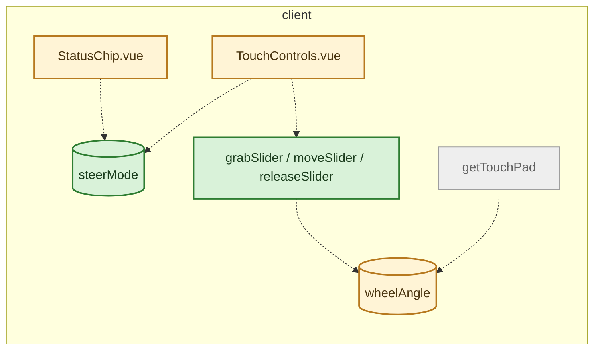
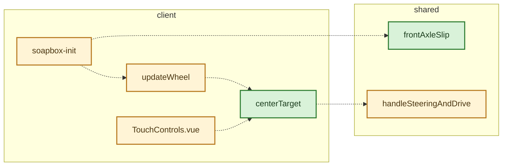
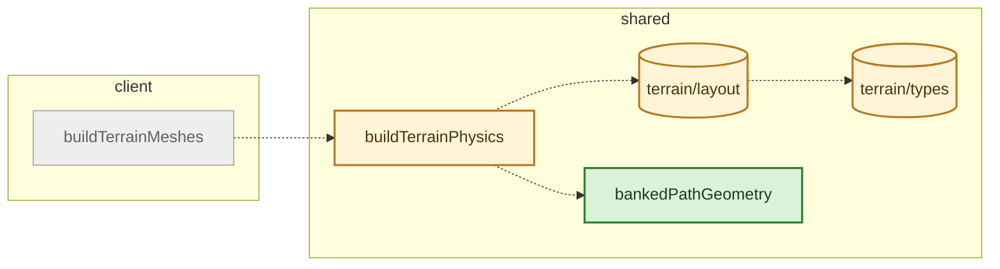

# Plan: slider steering, slide-aware centering, banked oval and S curve

Status: **draft. Review it, please.** No code yet.

Three changes in one plan. Each can ship alone, in this order:

1. **Slider steering (S).** A touch mode. A drag in the bottom half of the screen steers by its horizontal position.
2. **Slide-aware centering (C).** A released touch wheel goes to where the front wheels "want" to point, not to 0. A cue shows that angle.
3. **Banked oval and banked S curve (T).** Two new track pieces, from one general banked-road builder.

Not in this plan: slide-aware centering for keys and gamepad. Keys center in `shared/src/controls/handleSteeringAndDrive.ts` (`steering *= 0.9`). A gamepad has its own spring. See "Open questions".

## How this fits

The touch wheel is a client-only input. `vue-client/src/input/touch.ts` holds `wheelAngle`. `getTouchPad()` turns it into `pad.steer`. The pad goes to the server in `controls`. The server never sees the wheel, only `pad.steer`.

So changes S and C are **client only**. They change what the client sends, not how physics runs. No protocol change. No server change. Prediction stays correct, because the server applies the same `pad.steer` the client applied.

Change T is shared data. Server and client build the same colliders from `DEFAULT_TERRAIN_LAYOUT`. The `worldVersion` hash covers the layout, so an old tab sees a mismatch (from the terrain step, D5).

## What's new

Three diagrams, one per change. Legend: `notes/diagram-legend.md`. Node names are planned names.

**S. Slider steering.**



**C. Slide-aware centering.**



`target -.-> drive`: `centerTarget` reads `MAX_STEERING`, which `handleSteeringAndDrive.ts` must export (today it is a local `maxSteering`).

**T. Banked roads.**



No solid edge in any diagram: nothing new crosses the network.

`buildTerrainMeshes` needs no change. It already builds a mesh from any `TriMesh` collider.

---

## S. Slider steering

### S1. What it does

- A toggle turns slider mode on or off. Off by default. Saved in `localStorage`, like the gear (`touchGear`).
- With slider mode on, a pointer that **goes down** in the bottom half of the screen, and not on the wheel, a pedal, or the gear pill, steers.
- Steer comes from the pointer's x only. Screen center = straight. The span ends (S3) = full lock.
- The drag keeps steering after it leaves the bottom half. Pointer capture does this. Only the down point must be in the bottom half.
- The wheel stays. It is still an input. It also shows the steer angle from the slider, because both write the same `wheelAngle`.
- On release, the wheel centers as it does today (or as change C says).

### S2. Mechanics (not slots)

- A new full-width `steer-zone` element covers the bottom half, **under** the wheel, pedals, and gear in z-order. So those controls get their own pointers first. `touch-root` keeps `pointer-events: none`. The zone sets `auto` only while slider mode is on.
- The wheel's hit element is a square, but `onWheelDown` accepts only the circle. Today a tap in the square's corners does nothing. With slider mode on, the scaffold forwards a corner tap to the slider. (A DOM event does not fall through by itself.)
- **One steering owner at a time.** The first pointer that grabs (wheel or slider) owns steering until it lifts. A second steering pointer does nothing. The existing `held` flag becomes the owner record: `"none" | "wheel" | "slider"`.
- `releaseAll()` (touch hidden) also releases the slider.

### S3. Decisions for you to review

| # | Decision | Recommendation | Why |
| --- | --- | --- | --- |
| S3a | Absolute or relative | **Absolute.** A tap jumps steer to the finger x. | Your description: center = straight, edges = lock. Also needed for catching slides (see C5): put the finger on the cue. |
| S3b | Toggle location | A small switch in the `StatusChip` pill. | The pill is already the settings place (reload, fullscreen). The gear pill is for driving. |

Absolute has one cost: a tap far from the current steer makes a step in steer. The wheel jumps the same. Watch for it.

### S4. Your slots

| Slot | File (planned) | Decision | Where to look |
| --- | --- | --- | --- |
| Slider span | `vue-client/src/input/touch.ts` | Where full lock is: the screen edges, or the inner edges of the wheel and the pedals. | In landscape on a phone, the wheel and pedals cover the edges. Drag from the middle to each side. Can your thumb reach lock? |
| Slider center dead zone | `vue-client/src/input/touch.ts` | Width (px or fraction) at the center that gives 0. | Hold a thumb still at center at speed. Does the car weave? |
| Slider curve | `vue-client/src/input/touch.ts` | x (−1…1) to steer (−1…1). Same idea as `applyCurve`, but for the slider. | Small corrections at speed vs. reaching lock. |

Prediction to check: with 1:1 linear mapping, 1 px of thumb on a 800 px phone is 1/400 of lock. Lock is 0.45 rad (`maxSteering`) at the road wheels. At 30 m/s, what turn radius does 1 px give? Is the slider too sensitive at speed?

---

## C. Slide-aware centering

### C1. What reality does

Sources and confidence are at the end of this section.

Two separate effects turn a released steering wheel:

1. **Mechanical trail and kingpin inclination ("caster effect").** The tire contact patch sits behind the steering axis. A side force on the tire acts on that lever. It turns the tire **into the direction the tire is moving**, like a shopping-cart caster. Steering axis tilt also lifts the car a little when you steer, so the car's weight also pushes the wheels back toward straight. That second part works even at very low speed.
2. **Pneumatic trail (tire self-aligning torque).** The tire's own side force acts a little behind the patch center. This adds to effect 1 at small slip angles. At large slip angles this trail collapses, and the steering "goes light". The mechanical trail stays.

Result. With the wheel released, the front tires turn until their **side force is 0**. Side force is 0 when the front tire points exactly where the front axle is moving. That is **0 front slip angle**.

- Driving straight: the front axle moves straight ahead. Target = straight. Same as today.
- Oversteer slide: the rear swings out. The front axle moves toward the outside of the turn, relative to the car's nose. Target = **countersteer**, by the full angle between the nose and the front axle's path (up to lock). Not "slightly". In a big slide it can be a lot.
- That is why drifters let the wheel spin through their hands. The car finds the countersteer angle by itself. Then they catch the wheel when it is at the right point. Your plan to "let go, then pull it again" matches real technique.

One more real effect: when the rear grip comes back, the target swings back fast. A driver who holds full countersteer too long gets a slide the other way (a "tank-slapper"). Our centering never passes its target, so it follows the target as it swings back. It cannot overshoot by itself.

### C2. The model

`frontAxleSlip(body, frontOffset)` in `shared/src/vehicle/slip.ts`:

- Velocity of the front axle center: `v + ω × r`, with `r` = front axle offset in world frame. Front axle offset = `-length/3` along the chassis, from `shared/src/rapier/wheels.ts`.
- Split it into chassis forward and chassis lateral parts.
- Return the road-wheel angle that points along that velocity: `atan2(lateral, forward)`, plus the forward speed.
- Pure function in `shared`, so a gamepad force-feedback or a slip HUD can use it later. It reuses the chassis-axes math in `forwardSpeed` (moved to `shared/src/math.ts`, not copied).

`updateWheel` today moves `wheelAngle` toward 0 by a rate that grows with front rolling speed. New: it moves toward `centerTarget(...)` with the **same rate rule**. Only the target changes.

`centerTarget` converts the road-wheel angle to a wheel angle: `roadAngle / MAX_STEERING × halfLock`, clamped to the lock. (If you change `applyCurve` from linear, this needs its inverse. The scaffold notes it.)

Sign check: `touch.ts` uses clockwise = positive = steer right. Rapier steering is the other sign. The scaffold includes a small headless test: a car that slides left must give a target to the left of the nose, measured in wheel degrees. I verify the sign before you tune.

### C3. Effect 1 vs effect 2 at low speed

The 0-front-slip target is not defined at a stop (`atan2(0, 0)`), and in reverse it flips. In reality, effect 1's weight part centers toward straight at low speed, where side forces are small.

So the target is a blend: straight at low speed, 0 front slip at speed. How you blend is a slot (C4).

### C4. Your slots

| Slot | File (planned) | Decision | Where to look |
| --- | --- | --- | --- |
| Target blend | `vue-client/src/input/touch.ts`, `centerTarget` | How the target goes from straight (stopped, reverse) to 0 front slip (moving). Speed where it changes. | Reverse at walking speed and release. Then slide at speed and release. |
| Align gain | same | Fraction of the 0-front-slip angle to use, 0…1. 1 = what reality does (C1). | You asked for "slightly". Try 1 first, then lower it, and compare how a slide ends. |
| Rate in a slide | same, `centerStep` | Keep the rolling-speed rate, or add a faster rate when the gap to target is large. | Real wheels snap to countersteer fast in a slide. Is the current 960°/s cap fast enough? |

Prediction to check, before you run it: with align gain 1 and **no slide**, you release the wheel mid-corner. The target is then about the current steer, minus a small front slip. Does the wheel still return to straight? How fast, compared with today? (Hint: what happens to the car's path as the wheel moves a little toward the target?)

### C5. The cue: which way the wheel "wants" to go

Brainstorm. Each item has a cost and a reason.

| # | Cue | Cost | For | Against |
| --- | --- | --- | --- | --- |
| 1 | **Ghost notch** on the wheel rim at the target angle. The wheel already has an orange top notch. The ghost is a hollow orange notch. "Match the notches." | Small. One SVG element, one rotate in `draw()`. | Direct. Same units as the thing you grab. | On the wheel only. Your eyes are on the road. |
| 2 | **Gap arc** on the rim, from the real notch to the ghost. Color by gap size. | Small. | Shows how far, and which way, at a glance. | More ink on a see-through control. |
| 3 | **Slider ghost tick** at the bottom of the screen at the target x. | Small. Slider mode only. | Tells you exactly where to put the thumb for an absolute grab (S3a). | Only useful in slider mode. |
| 4 | **3D arrow** at the car's nose, along the front axle's path. | Medium. A Three.js mesh in the chase view. | Your eyes are already on the car. Shows the physics, not the control. | Can clutter. Needs depth and contrast care. |
| 5 | **Rim tint by slide size.** The wheel rim warms as the front slip grows. | Small. | Says "you are sliding" before you look for the notch. | Says how much, not where. |
| 6 | **Haptic** tick when the thumb passes the target. `navigator.vibrate`. | Small. | No look needed. | Android only. iOS Safari has no `vibrate`. |

Recommendation: **1 + 3, shown only when the gap passes a threshold.** Both show the target in the units you grab with. They hide in normal driving, so the screen stays clean. Add 5 if the notch alone is hard to see in a fast slide. Keep 4 as a later idea.

The cue threshold is a slot (`vue-client/src/components/TouchControls.vue`). Where to look: drive normal corners, then slide. The cue should stay off in the first and come on in the second.

### C6. Sources and confidence

- Mechanical trail and caster turn the tire into the side force: [Caster angle, Wikipedia](https://en.wikipedia.org/wiki/Caster_angle). Confident.
- Pneumatic trail falls as slip angle grows, so self-aligning torque falls near the limit: [Pneumatic trail, Wikipedia](https://www.wikipedia.org/wiki/Pneumatic_trail), [Self aligning torque, Wikipedia](https://en.wikipedia.org/wiki/Self_aligning_torque). Confident.
- Restoring moment = side force × (pneumatic trail + caster trail), so the caster part remains when the pneumatic part collapses: [US patent 6895317](https://image-ppubs.uspto.gov/dirsearch-public/print/downloadPdf/6895317) (grip estimation patents use this). Confident in the form. Not checked: real magnitudes.
- "Released wheel goes to 0 front slip, which is full countersteer in a slide": my derivation from the lines above, plus the common drift advice to let the wheel self-steer. I found no measured source for how fast a real wheel gets there, or how power steering changes it. Treat the rate as a feel choice, not a fact.

---

## T. Banked oval and banked S curve

### T1. One general builder

Today `bankedTurnGeometry` builds one arc that bends toward −X. An oval and an S curve need straights, both turn directions, and a bank that changes sides.

Plan: replace the `bankedTurn` kind with a **`bankedPath`** kind. A path is a list of segments. One geometry builder walks the list.

```ts
type PathSegment =
  | { type: "straight"; length: number }
  | { type: "arc"; turn: "left" | "right"; radius: number; angle: number }

type BankedPathPiece = PieceBase & {
  kind: "bankedPath"
  roadWidth: number
  segments: PathSegment[]
  /** Full bank on arcs, radians. Straights are flat. The outer edge of each arc is the high edge. */
  bankAngle: number
  /** Length (m) over which the bank eases between segments. */
  easeLength: number
  /** Last point joins the first. For an oval. */
  closed: boolean
  /** Samples per metre along the center line. */
  resolution: number
}
```

- The existing turn becomes a path with one `arc` (right, 180°). It keeps its look. Its vertices change a little (ease by length, not by angle), so `worldVersion` changes. That is expected.
- The **low edge stays on the ground** and the high edge lifts. On a left arc the left edge is low, on a right arc the right edge is low. Where the bank changes sides, it eases through 0, so the road is flat at the crossover and has no step.
- Why not pivot on the center line: half the road would go below `y = 0`, into the ground box.
- `bankedPathGeometry` replaces `bankedTurnGeometry`. Same output: `{ vertices, indices }`, used for the `trimesh` collider and, through it, the mesh.

### T2. The two layouts

- **Oval.** `closed: true`. Straight, 180° left, straight, 180° left. You drive onto it from the infield: the inner edge is on the ground.
- **S curve.** Arc left, then arc right, with a short straight (or none) between them. Open ends ease to flat, like the current turn.

### T3. Problem: the high edge is a cliff

A road surface is a thin sheet. Edge height = road width × tan(bank). At 30° and a 7 m road, the outer edge is about 4 m up. Today's 15° turn already has a 1.9 m edge.

- Off the outside: the car falls about 4 m to the ground.
- From the outside at ground level: the car drives **under** the sheet.

Plan: the builder also makes a **skirt**, a vertical face from the high edge down to the ground. It closes the shape. Then a car from outside hits a wall instead of going under. Not a slot: it is the same in every choice.

An outer **barrier** (a wall on top of the high edge, like a race track wall) is a real choice. See the slots.

### T4. Your slots

| Slot | File (planned) | Decision | Where to look |
| --- | --- | --- | --- |
| Oval size and bank | `shared/src/terrain/layout.ts` | Arc radius, straight length, bank angle, road width. One block. | The no-friction speed of a banked curve: `v² = g · r · tan(θ)`. Pick the speed you want to hold, then the radius or the angle. Top speed is 42 m/s. |
| S curve size and bank | same | Radius and angle of each arc, the straight between them, bank angle. | Drive it at the speed of the oval. Does the bank change sides in time? |
| Bank ease length | same | How long the bank takes to change. | Too short: a jolt at the crossover. Too long: the arc is not banked when you need it. |
| Outer barrier | `shared/src/terrain/layout.ts` (height), builder in `pieces.ts` | Height of a wall on the high edge. 0 = none. | Go too fast on the oval. Fly off, or hit a wall? |
| Placement | same | Where each piece sits. | The arena is ±500 m. Today's pieces sit near z = 30…140 and x = 30. |

Prediction to check: stop the car on a 30° bank, off the pedals. Does it slide down the bank? What in `shared/src/terrain/surfaces.ts` and `wheels.ts` decides that? Then the same at 15°.

---

## Test plan

- `npm run build` passes (CI runs it too).
- Headless test: `frontAxleSlip` sign and size for a car that slides left, right, and goes straight.
- Headless test: `bankedPathGeometry` closes the oval with no gap at the seam, and the bank is 0 at the S crossover.
- Headless screenshots: slider zone, ghost notch, slider ghost tick, the oval, and the S curve.
- Not possible in the cloud session: feel on a real phone, and server-client agreement on the new pieces with a live server. You check those.

## Open questions

- Slide-aware centering for keys and gamepad later? Keys would need the target in `shared` (server and client both run key steering). A gamepad has a physical spring, so only force feedback could do it.
- Should slider mode hide the wheel's hit area (keep it only as a display)? The plan keeps it as an input, as you asked.
- Keep the old 180° banked turn, or remove it now that the oval exists?
