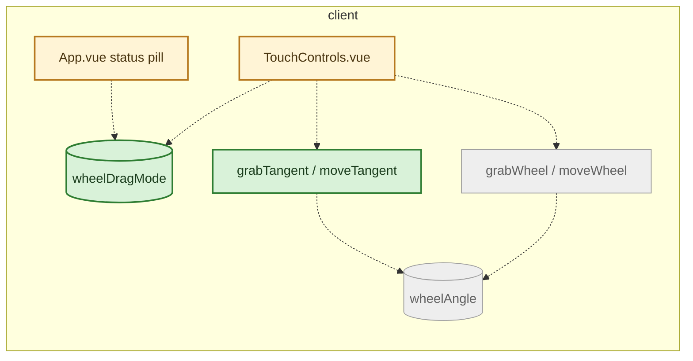

# Plan: tangent drag for the touch wheel (optional mode)

Status: **approved. Scaffold pushed in this PR.** Your slots are marked `YOUR CHOICE` in the code. Part of a larger PR (#11). This plan covers only this change (W).

Source: the owner's attachment in the PR #11 review. Changed here only where it pointed at shelved or replaced parts of the larger plan: "How this fits the larger PR", "Resolved questions", and the C5 reference in W6.

## Goal

Add a second way to drag the touch wheel, behind a toggle. Today the wheel uses **angular** drag. The new mode is **tangent** drag:

- At touch-down, take the point on the wheel rim nearest the finger.
- Take the rim's tangent line at that point. That line is a slider for this drag. Its zero is the touch-down point.
- Finger travel **along** that line turns the wheel. Travel across it does nothing.
- Each new touch makes a new slider, with an orientation set by where it starts.

Angular stays the default. The toggle is off by default.

Not in this plan: the bottom-half horizontal slider. It is shelved. See "Shelved: bottom-half slider" in `slide-steering-and-banked-track.md`.

## Today (merged in #10, plus `5123c4c`)

- `vue-client/src/input/touch.ts`: `grabWheel`, `moveWheel`, `releaseWheel` do angular drag. `wheelAngle` is the state. `WHEEL_GAIN = 1` (1:1). `VISUAL_LOCK = 900°`. `DEAD_RADIUS_FRAC = 0.25`.
- `updateWheel` centers from front-wheel rolling while not held, with `CENTER_SAT_SPEED`.
- `getTouchPad()` maps `wheelAngle / halfLock` through `applyCurve` to `pad.steer`.
- `vue-client/src/components/TouchControls.vue`: wheel center sits `EDGE_MARGIN + R` from the left and bottom edges. `R = S * PHONE_WHEEL_RADIUS_FRAC` (0.21) on phones, `WHEEL_RADIUS_FRAC` (0.16) elsewhere. `onWheelDown` captures the pointer and passes `dx`, `dy`, `radius`.
- Status pill (reload, fullscreen) is in `vue-client/src/App.vue`.

## How this fits

Client only. Tangent drag writes the same `wheelAngle` as angular drag. Everything after `wheelAngle` stays the same: `applyCurve`, `getTouchPad`, centering, the SVG rotation, and `pad.steer` on the wire. No protocol change. No server change.

## What's new



No solid edge: nothing new crosses the network.

## W1. The mode

- `export const wheelDragMode = ref<"angular" | "tangent">(load())` in `touch.ts`. Saved in `localStorage` key `touchWheelDrag`, with `try/catch`, like `touchGear`.
- `setWheelDragMode(next)`. Ignore a change while the wheel is held. Apply it on the next grab.
- Toggle: one small item in the status pill in `App.vue`. It sits next to reload and fullscreen. It shows only while `touchVisible` is true.
- Icon: a small inline SVG, not a text glyph. Do not use a circular arrow: reload already uses `↻`. Angular = a ring with a dot on the rim and a short arc beside it. Tangent = a ring with a straight line touching the rim. Same size and stroke as the other pill icons. Add `title` and `aria-label` ("Wheel drag: angular" / "Wheel drag: tangent").
- The pill is the settings place. The gear pill stays for driving.

## W2. Mechanics (not slots)

Screen px, y down. Clockwise on screen = positive `wheelAngle` = steer right. This matches the sign note at the top of `touch.ts`.

**Grab** (`grabTangent(dx, dy, radius)`), `dx`, `dy` from the wheel center:

1. `r = hypot(dx, dy)`.
2. If `r ≥ radius * DEAD_RADIUS_FRAC`: `u = (dx, dy) / r`. Else: `u = (0, -1)`. A grab near the center acts like a grab at the top of the rim. Then drag right = steer right.
3. Clockwise tangent: `t = (-u.y, u.x)`. Check: top `u = (0,-1)` gives `t = (1, 0)`, so right is clockwise. Right side `u = (1,0)` gives `t = (0, 1)`, so down is clockwise.
4. Store `t`, the touch-down point `p0 = (dx, dy)`, and `angle0 = wheelAngle`.
5. `held = true`.

The slider zero is the touch-down point, not the rim point. Only the direction comes from the rim. So the wheel does not jump at touch-down.

**Move** (`moveTangent(dx, dy)`):

1. `s = (dx - p0.x) * t.x + (dy - p0.y) * t.y`. Signed px along the slider.
2. `wheelAngle = clamp(angle0 + s * TANGENT_GAIN, ±halfLock)`.
3. Absolute from the grab, not incremental. So the finger going back to `p0` always gives `angle0` back. No drift.

**Release**: `releaseWheel()` as today. Centering starts again.

**Dispatch**: `TouchControls.vue` reads `wheelDragMode` in `onWheelDown` and calls `grabTangent` or `grabWheel`. It stores which one was used, and routes moves to the matching function until release. A mode change in the middle of a drag cannot split a drag.

**Hit test**: same circle as today (`HIT_FRAC`). Pointer capture keeps the drag alive off the wheel.

## W3. Reach and wheel placement

The finger cannot go past the screen edge. So the slider's length depends on where the wheel sits.

Name the slider reach `L` px. That is how far the finger must go along `t` from `p0` to reach the target angle. From any grab point on a circle of radius `R`, the slider runs along a tangent line. All the points it can reach in ±L are within `√(R² + L²)` of the center. So:

> Full reach in every direction, from every grab point, needs the wheel center at least `√(R² + L²)` from the left edge and from the bottom edge (plus safe area).

Today, on a phone in landscape (`S ≈ 390`, `R ≈ 82`, center `≈ 106` px in), the worst-case reach is `√(106² − 82²) ≈ 67` px. Most grab points have much more room. The worst cases are grabs on the lower-left part of the rim, dragging toward the corner.

`TANGENT_GAIN` and `L` are linked: `TANGENT_GAIN = halfLock / L` gives lock at `L` px from a centered wheel. At `L = 67`, that is about 6.7° of wheel per px.

A new grab starts from the current `wheelAngle`, not from 0. So from full left lock to full right lock needs `2L`. With centering, most grabs start near 0.

## W4. Decisions (reviewed)

| # | Decision | Status |
| --- | --- | --- |
| W4a | Wheel placement in tangent mode: center distance = `max(EDGE_MARGIN + R, √(R² + L_min²))`. The `layout` computed in `TouchControls.vue` reads `wheelDragMode`. The wheel moves when you flip the toggle. | Agreed. |
| W4b | Gain is in radians per px. Two reach modes, as a slot (W4b-1, W4b-2). Default: fixed. | Agreed. Owner compares both on a phone. |
| W4c | Track cue while held, behind its own toggle. Off by default. | Agreed, if it stays quiet (see W6). |
| — | Center grab acts like a grab at the top. | Agreed. |
| — | `tangentCurve` linear. | Agreed. Not a slot for now. |

### W4b-1. Fixed reach (default)

- One gain for every grab: `TANGENT_GAIN = halfLock / L_min`.
- `L_min` = the shortest reach any grab point and direction can have. With W4a, `L_min` is `TANGENT_REACH_PX`, because the wheel moves until every direction has that much room.
- Without W4a, `L_min ≈ 67` px on a phone today. That gives about 6.7° per px, which is twitchy. W4a is the control for this.
- For muscle memory: the same thumb travel gives the same wheel turn, every time, in both directions.

### W4b-2. Edge reach (experiment)

- At grab, cast a ray from `p0` along `+t` and along `−t` to the viewport rect, minus `EDGE_MARGIN` and the safe area. That gives `Lplus` and `Lminus`.
- Steer: `s ≥ 0` → `angle0 + (s / Lplus) · (halfLock − angle0)`. `s < 0` → `angle0 − (|s| / Lminus) · (halfLock + angle0)`.
- So the screen edge is always exactly lock, from any grab point, from any start angle.
- Costs:
  - Gain changes with each grab. One grab can need 60 px to lock, the next 400 px.
  - Gain changes inside one drag, at `p0`. Left and right have different rates, so there is a kink at the zero.
  - A thumb cannot learn one "px per degree". It must read the cue (W4c) or the screen edge.
- If edge reach is close but too varied: clamp `Lplus` and `Lminus` to `[L_min, TANGENT_REACH_MAX_PX]`. This is a middle choice. It is not in the scaffold unless you ask.

## W5. Your slots

| Slot | File (planned) | Placeholder | Decision | Where to look |
| --- | --- | --- | --- | --- |
| `TANGENT_REACH_PX` (`L_min`) | `touch.ts` | `120` | px of finger travel from a centered wheel to lock. Sets `TANGENT_GAIN` and, with W4a, the wheel position. | Short = quick lock, twitchy at speed. Long = calm, but the wheel moves further in from the corner. |
| `TANGENT_REACH_MODE` | `touch.ts` | `"fixed"` | `"fixed"` (W4b-1) or `"edge"` (W4b-2). | Drive ten slaloms in each mode. In which mode do you stop looking at the wheel first? |
| `WheelCue.vue` | `vue-client/src/components/WheelCue.vue` (new) | the W6 look, fully built | How the track line, lock ticks, target tick, and outside-track chevron look. | Fast slide vs normal corner. Visible when needed, quiet otherwise? |

Slots are where the owner writes code. Each one is a working default with a `// YOUR CHOICE` marker.

### `WheelCue.vue` slot

The cue is a **Vue component you edit as HTML and CSS**. Each thing on screen is one element in its template, with a class named after what it is. To change how something looks, find its element and its CSS rule. You should not need to read drag math or `rAF` code.

**Where it lives**

```
vue-client/src/components/
  TouchControls.vue      ← mounts <WheelCue> inside the touch overlay
  WheelCue.vue           ← YOUR CHOICE: the whole cue look (template + scoped CSS)
```

DOM, as you see it in DevTools:

```
div.touch-root
  svg.wheel-cue                 ← full-screen, pointer-events: none
    g.cue                       ← placed at p0, turned to the tangent
      line.track                ← the slider line, from -minus to +plus
      line.lock-tick.minus      ← tick at the minus lock end
      line.lock-tick.plus       ← tick at the plus lock end
      circle.finger             ← where the finger is on the track now
      g.target                  ← the "wheels want to go here" mark (change C)
        path.target-tick        ← hollow tick, on the track
        path.target-chevron     ← shows instead when the target is past a track end
```

**How it gets data**

- Props: `cue: TrackCue` (below). Plain numbers. The component reads nothing else: not `touch.ts`, not the car.
- The template draws the cue in **track space**: x runs along the slider (px from `p0`), y runs across it. So `line.track` is just `x1 = -minus`, `x2 = plus`, `y = 0`. Ticks and marks are placed by x only.
- Only `g.cue` gets a screen transform: `translate(origin) rotate(atan2(dir))`. Everything inside it stays in simple track space.
- Speed: the parent updates the props in its `rAF` `draw()`, once per frame, only while the cue shows. One small component at 60 fps is fine. If a profile ever says otherwise, the parent can set the same values as CSS variables (`--finger`, `--target`) instead. The template stays the same. The scaffold notes this in a comment. It does not do it up front.

```ts
type TrackCue = {
  visible: boolean        // held, tangent mode, cue toggle on
  fade: number            // 1 while held, then 1 → 0 over the release fade
  origin: { x: number; y: number }   // p0, screen px
  dir: { x: number; y: number }      // t, unit
  minus: number           // Lminus, px
  plus: number            // Lplus, px
  finger: number          // s now, px
  target: { s: number; clamped: boolean } | null  // null if target mark off or C not built
}
```

`TrackCue` is built in `TouchControls.vue` from `touch.ts` state. That code is plumbing, not part of the slot.

**Default look (built in the scaffold)**

- All style lives in `<style scoped>` in `WheelCue.vue`, as CSS custom properties at the top: `--cue-color`, `--cue-opacity`, `--track-width`, `--tick-length`, `--fade-ms`, `--target-color`.
- Defaults are the W6 look: 1 px white line at 30%, short lock ticks, small hollow target tick.
- Show and hide with `v-if="cue.visible"` and `opacity: cue.fade`. No JS animation.
- A short comment at the top of the template lists each class and what it is on screen.

## W6. Track cue (W4c), and the target mark from change C

- Own toggle: `wheelTrackCue`, saved in `localStorage` key `touchWheelCue`. Off by default. Only applies in tangent mode.
- Look: 1 px line, 30% white, along `t` through `p0`, from `−Lminus` to `+Lplus`. With fixed reach, both are `L_min`. Short ticks at the lock ends. Shows only while held. It fades out over about 150 ms on release.
- It is drawn by `WheelCue.vue` (see the slot above).
- **Target mark from change C.** If slide-aware centering (C) is in, its target angle shows on the track too, as a small hollow tick:
  - Position: `s_target = (targetAngle − angle0) / gain` along `t`, with the gain of that side in edge mode.
  - Outside the track: clamp it to the track end. Draw it as a small chevron that points outward.
  - Own toggle: `wheelTargetMark`, key `touchWheelTarget`. Off by default. Does nothing without C.
  - It uses the same target value as C5's gap arc and haptic tap. Do not compute it twice. Read it from `centerTarget`.
- The pill now has up to three new toggles (drag mode, track cue, target mark). If the pill gets crowded, put the three behind one small "wheel" item that opens a row. This is a layout choice, not a slot.

Prediction to check before you run it: grab at the **bottom** of the wheel and drag your thumb left along the rim, the way a real wheel turns. In tangent mode, which way does the wheel turn? Now keep going around the rim past a quarter turn. What happens, and why? Compare it with angular mode.

## Test plan

- `npm run build` passes.
- Headless test of the pure functions: for grabs at top, right, bottom, left, and a center grab, a drag of `+L` along `t` gives `+halfLock` (clockwise / right). A drag across `t` gives no change. A return to `p0` gives `angle0`.
- Headless test of W4a: for the phone and desktop layouts, the corner points `p0 ± L·t` stay inside the viewport for 36 grab angles.
- Headless test of edge reach: for 36 grab angles, `p0 + Lplus·t` and `p0 − Lminus·t` land on the inset viewport rect, and a drag to each gives exactly `±halfLock`.
- Headless screenshot: tangent mode with the track cue at a lower-left grab, with and without the target mark. Also the pill with the new icons next to reload.
- Toggle check: flip the mode while not held, then while held. While held, the drag must not change mode.
- Not possible in the cloud session: feel on a real phone. You check that.

## How this fits the larger PR

`slide-steering-and-banked-track.md` holds changes C (slide-aware centering) and T (banked roads). The bottom-half slider (S) is shelved there, with the reasons.

- W changes **how a wheel grab maps to `wheelAngle`**. It needs no new grab area and no steering-owner record, because the wheel is the only steering pointer.
- C (slide-aware centering) acts only while not held, so it does not care which drag mode was used. W6 shows C's target on the track. It reads `centerTarget`, so build C first, or stub `centerTarget` to return 0.
- All new toggles go in the status pill in `App.vue`.

## Resolved questions

- Angular `WHEEL_GAIN = 1` **stays**.
- Angular stays available. Tangent is a separate option, for testing, maybe indefinitely.

## Zero new maintenance problems

This is a hard rule for the scaffold.

- Angular code (`grabWheel`, `moveWheel`) does not change. Tangent code is new functions next to it. The only shared change is the dispatch in `onWheelDown`.
- Both modes write `wheelAngle` and use `halfLock`, `DEAD_RADIUS_FRAC`, `releaseWheel`, and centering. No copies of constants or helpers.
- Settings use one small helper for `localStorage` refs with `try/catch`. Move `loadGear`/`setGear` onto it too, so there are not four copies of the same pattern. Behavior stays the same.
- Layout: one function gives the wheel center distance for the current mode. `layout` calls it. No second layout path.
- The cue look lives in `WheelCue.vue`. It gets only plain props, so it has no tie to input state.
- The headless tests in the test plan cover the tangent math and the edge ray. They are part of the scaffold, not a later step.
- If a part of this plan would need a special case in angular mode, stop and ask the owner. Do not add the special case.
