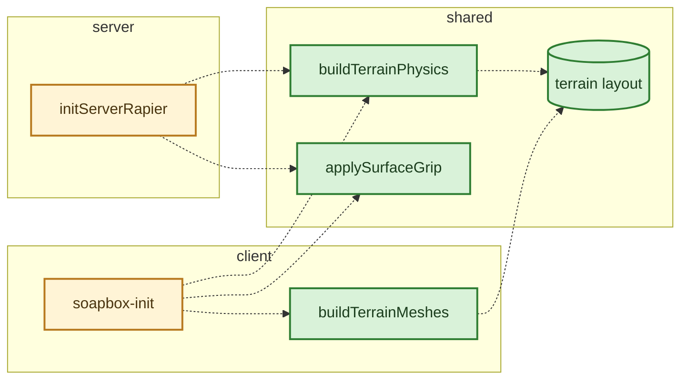

# Plan: terrain (roadmap step 2)

Status: **draft. Waiting for owner review.** Comment on any line. Ask anything.

## Goal

Add a starter set of terrain. Drive on it. Then decide which car parameters are worth exposing in step 3.

Starter set:

1. **Bumps.** A row of bumps after the spawn ramp.
2. **Banked turn.** One 180° turn with a tilted road surface.
3. **Rough patch.** An off-road area with uneven ground and less grip.

Not in this step: full tracks, banked ovals, hills across the whole arena. Those come after we drive on the starter set.

## What's new

Legend: `notes/diagram-legend.md`. No solid edge: terrain never crosses the network.

## How this fits

The server and the client each run their own physics world. Both worlds must hold the **same** terrain. If they differ, the client predicts one path and the server corrects it to another. The car then jitters or snaps.

Today the ramp, ground, and walls are each one function in `shared/src/rapier/`. Each side calls them. The client then builds a mesh from the size each function returns.

Terrain follows the same idea, with one change: **one layout list is the single source.**

- `terrain layout` is a plain data list in `shared`. Each item is one piece: kind, position, rotation, and size values.
- `buildTerrainPhysics` reads the list and makes the Rapier colliders. Server and client both call it.
- `buildTerrainMeshes` reads the same list and makes the Three.js meshes. Only the client calls it.

So the collider and the mesh for a piece always come from the same numbers. They cannot drift apart.

## Decisions for you to review

Each item has my recommendation. Comment to change it.

### D1. How to make each shape

| Piece | Recommendation | Why |
| --- | --- | --- |
| Bumps | One primitive collider per bump | Simple. One collider, one mesh. Easy to tune. |
| Banked turn | One generated mesh, used for **both** a Rapier `trimesh` collider and the Three.js geometry | A smooth curve. Same vertices on both sides. |
| Rough patch | One Rapier `heightfield` over a limited area | The natural shape for uneven ground. Same height grid builds the mesh. |

Rule for all three: generate the shape **once** in `shared`. Physics and visuals both use that output.

### D2. Rough patch heights must be the same on both sides

Uneven ground needs "random" heights. Plain `Math.random()` gives different heights on the server and the client. The plan uses a **seeded** generator in `shared`. Same seed, same heights, on both sides.

### D3. How off-road grip works

My understanding: Rapier's raycast vehicle takes grip only from each wheel's own `frictionSlip`. It ignores the ground collider's friction. So a "low-friction" collider alone may not change how the car drives. **We verify this in the scaffold before we depend on it.** (Prediction for you: set ground friction to 0. Does the car slide?)

Plan:

- At build time, `buildTerrainPhysics` records which collider is which surface: road or dirt.
- Each physics step, `applySurfaceGrip` asks each wheel what it touches (`vehicle.wheelGroundObject(i)`), then sets that wheel's `frictionSlip` for that surface.
- It lives in `shared`. Server and client both call it every step, before `updateVehicle`. Same rule on both sides, so prediction stays correct.

### D4. Where the pieces go

The car spawns on the ramp and rolls toward **+Z**. The ramp ends near z = 5.

Proposal:

- Bumps from about z = 30 to z = 60, in line with the ramp.
- Banked turn past that, near z = 100.
- Rough patch to one side, so you can choose to drive into it.

Exact positions are a slot for you (see below).

### D5. Old browser tab, new server

Both sides build the terrain from code. If an open browser tab has old code and the server has new code, the terrains differ. Today the fix is: reload the tab. A version check in the `welcome` message would catch it. That is a wire protocol change.

Recommendation: **not in this step.** Note it and move on. Comment if you want it now.

## Your slots

I will push a scaffold that builds and runs, with a placeholder in each slot. You make these choices, run, and watch.

| Slot | File (planned) | Decision | Where to look |
| --- | --- | --- | --- |
| Bump shape | `shared/src/terrain/pieces.ts` | Which collider shape is a good bump | `RAPIER.ColliderDesc.*` |
| Bump size and spacing | `shared/src/terrain/layout.ts` | Height, width, gap, count | Drive over them |
| Bank angle and radius | `shared/src/terrain/layout.ts` | How steep, how tight | Drive around it |
| Rough patch roughness | `shared/src/terrain/layout.ts` | Height range, grid resolution | Drive into it |
| Surface grip | `shared/src/terrain/surfaces.ts` | `frictionSlip` for road and dirt | Feel the difference |
| Placement | `shared/src/terrain/layout.ts` | Where each piece sits | Drive the course |

The exact file names can change in the scaffold. The slots stay the same.

## Test plan

- `npm run build` passes (CI runs it too).
- Headless screenshots of each piece.
- Server and client agree: a car on each piece shows no correction snaps. I can only check this partly in the cloud session. You check it with a live server.

## Open questions

- Anything in the starter set you would swap for something else?
- Do you want a live tuning panel (sliders) for the slot values? Physics sliders change only your local world, so they put you out of sync with the server. They are for solo testing only.
