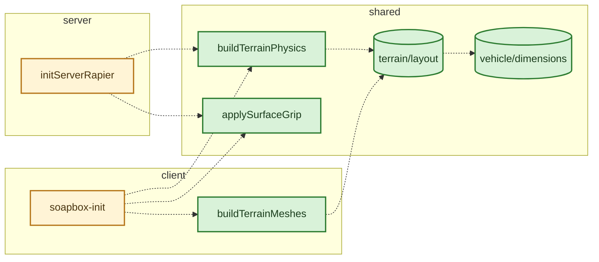
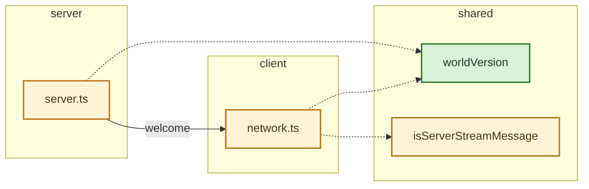

# Plan: terrain (roadmap step 2)

Status: **draft, revision 2. Waiting for owner review.** Comment on any line. Ask anything.

Revision 2 changes (from your first review): car-scaled bump sizes, bump size and placement grouped, the version check moved into this step, a new section on later tuning, and the diagram updated.

## Goal

Add a starter set of terrain. Drive on it. Then decide which car parameters are worth exposing in step 3.

Starter set:

1. **Bumps.** A row of bumps after the spawn ramp.
2. **Banked turn.** One 180° turn with a tilted road surface.
3. **Rough patch.** An off-road area with uneven ground and less grip.

Not in this step: full tracks, banked ovals, hills across the whole arena. Those come after we drive on the starter set.

## What's new

Two diagrams, one per change. Together they would need 9 nodes, over the limit of 8.

**Terrain build.** Server and client build the same terrain from one data list.

No solid edge: the terrain never crosses the network.

**Version check (D5).** The server tells each client which layout it runs.

Node names are the planned module and symbol names.

Legend: `notes/diagram-legend.md`. The terrain itself never crosses the network. The one solid edge is the version check (D5): `welcome` now carries a hash of the layout.

## How this fits

The server and the client each run their own physics world. Both worlds must hold the **same** terrain. If they differ, the client predicts one path and the server corrects it to another. The car then jitters or snaps.

Today the ramp, ground, and walls are each one function in `shared/src/rapier/`. Each side calls them. The client then builds a mesh from the size each function returns.

Terrain follows the same idea, with one change: **one layout list is the single source.**

- `terrain layout` is a plain data list in `shared`. Each item is one piece: kind, position, rotation, and size values.
- `buildTerrainPhysics` reads the list and makes the Rapier colliders. Server and client both call it.
- `buildTerrainMeshes` reads the same list and makes the Three.js meshes. Only the client calls it.

So the collider and the mesh for a piece always come from the same numbers. They cannot drift apart.

## Decisions for you to review

Each item has my recommendation. Comment to change it.

### D1. How to make each shape

| Piece | Recommendation | Why |
| --- | --- | --- |
| Bumps | One primitive collider per bump | Simple. One collider, one mesh. Easy to tune. |
| Banked turn | One generated mesh, used for **both** a Rapier `trimesh` collider and the Three.js geometry | A smooth curve. Same vertices on both sides. |
| Rough patch | One Rapier `heightfield` over a limited area | The natural shape for uneven ground. Same height grid builds the mesh. |

Rule for all three: generate the shape **once** in `shared`. Physics and visuals both use that output.

Bumps: the heightfield builder exists anyway for the rough patch. So the scaffold lets a bump be either kind: a primitive collider or a small heightfield. That choice is your bump-shape slot.

### D2. Rough patch heights must be the same on both sides

Uneven ground needs "random" heights. Plain `Math.random()` gives different heights on the server and the client. The plan uses a **seeded** generator in `shared`. Same seed, same heights, on both sides.

### D3. How off-road grip works

My understanding: Rapier's raycast vehicle takes grip only from each wheel's own `frictionSlip`. It ignores the ground collider's friction. So a "low-friction" collider alone may not change how the car drives. **We verify this in the scaffold before we depend on it.** (Prediction for you: set ground friction to 0. Does the car slide?)

Plan:

- At build time, `buildTerrainPhysics` records which collider is which surface: road or dirt.
- Each physics step, `applySurfaceGrip` asks each wheel what it touches (`vehicle.wheelGroundObject(i)`), then sets that wheel's `frictionSlip` for that surface.
- It lives in `shared`. Server and client both call it every step, before `updateVehicle`. Same rule on both sides, so prediction stays correct.

### D3b. Size pieces from the car

Bump and turn sizes come from the car's own dimensions, not from free numbers. Example: bump length (along the road) = a multiple of tire width.

Problem: today the car's sizes are local constants inside functions. Chassis size is in `shared/src/rapier/chassis.ts`. Wheel radius is in `shared/src/rapier/wheels.ts`. Tire width (0.15 m) exists only in the client mesh code, `vue-client/src/three/wheels.ts`. The physics has no tire width at all, because each wheel is a ray.

Plan: move these into one `shared` module, `vehicle dimensions`. Chassis, wheels, the client wheel mesh, and the terrain layout all read it. This is also the first piece of the step 3 vehicle spec.

Prediction to check: each wheel is one ray straight down from its hub. At speed, the car moves about 0.3 m per physics step (1/60 s). What happens to a bump that is shorter than that, along the road?

### D4. Where the pieces go

The car spawns on the ramp and rolls toward **+Z**. The ramp ends near z = 5.

Proposal:

- Bumps from about z = 30 to z = 60, in line with the ramp.
- Banked turn past that, near z = 100.
- Rough patch to one side, so you can choose to drive into it.

Exact positions are a slot for you (see below). In `layout.ts`, each piece's placement and its spacing sit together in one block, because they depend on each other.

### D5. Old browser tab, new server

Both sides build the terrain from code. If an open browser tab has old code and the server has new code, the terrains differ. Today the fix is: reload the tab.

**In this step** (small: about 30 lines):

- `shared` computes `worldVersion`: a short hash of the layout data. Any layout edit changes it automatically. No manual version number to forget.
- `WelcomeMessage` in `shared/src/protocol.ts` gets a `worldVersion` field. The validator checks it.
- The server sends its value. The client compares it with its own.
- On a mismatch, the client reacts. How it reacts is a slot for you.

Limit: the hash covers layout **data** only. A change to builder **code** with the same data does not change the hash. The tuning section below fixes this later.

Limit: browser tabs opened before this ships do not have the check. They still need a manual reload once.

## Your slots

I will push a scaffold that builds and runs, with a placeholder in each slot. You make these choices, run, and watch.

| Slot | File (planned) | Decision | Where to look |
| --- | --- | --- | --- |
| Bump shape | `shared/src/terrain/pieces.ts` | Primitive collider or small heightfield. If primitive, which shape | `RAPIER.ColliderDesc.*` |
| Bump size, spacing, and placement | `shared/src/terrain/layout.ts` | Size as multiples of car dimensions. Gap, count, position. One block | `vehicle dimensions`. Drive over them |
| Bank angle, radius, and placement | `shared/src/terrain/layout.ts` | How steep, how tight, where | Drive around it |
| Rough patch roughness and placement | `shared/src/terrain/layout.ts` | Height range, grid resolution, where | Drive into it |
| Surface grip | `shared/src/terrain/surfaces.ts` | `frictionSlip` for road and dirt | Feel the difference |
| Version mismatch | `vue-client/src/network.ts` | What the client does: reload by itself, or show a notice | Try it with two layouts |

The exact file names can change in the scaffold. The slots stay the same.

## Built for tuning later

Not in this step. Tuning sliders come later, and they must keep server and client in sync. This step prepares for them:

- **All tunable values are plain data.** Layout pieces, surface grip, and vehicle dimensions are plain JSON-safe objects. Code never hides a tunable value inside a function. Data can go on the wire. Code cannot.
- **The terrain can rebuild.** `buildTerrainPhysics` returns a handle with `dispose()`. It removes every collider it made. The client meshes work the same way. A tune then means: dispose, then build from the new data.
- **One function per surface rule.** `applySurfaceGrip` reads the grip table it receives as an argument. It does not read a module constant. A tuned table then works with no code change.

Later design (for reference, not built now):

- Terrain and surfaces are **shared by all players**. A terrain tune changes everyone's world. Flow: client sends a `tune` message, the server applies it, then broadcasts the new data to all clients.
- Vehicle values are **per player**. They travel with each player's vehicle spec (step 3).
- With tuning, the server sends the current world data at join, not only its hash. The client builds from what the server sends. That also closes the code-version gap from D5.

## Test plan

- `npm run build` passes (CI runs it too).
- Headless screenshots of each piece.
- Server and client agree: a car on each piece shows no correction snaps. I can only check this partly in the cloud session. You check it with a live server.

## Open questions

- Anything in the starter set you would swap for something else?
